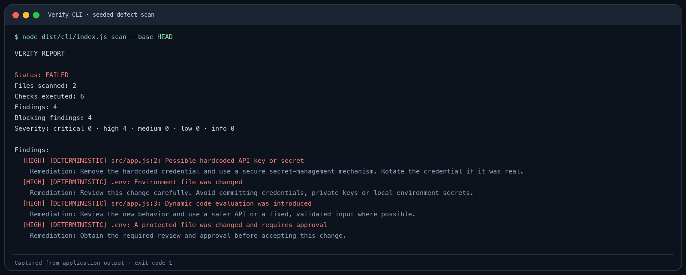
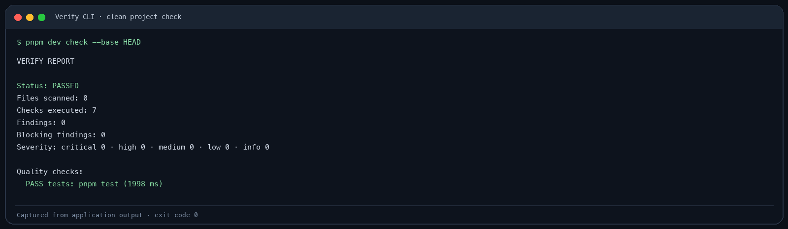
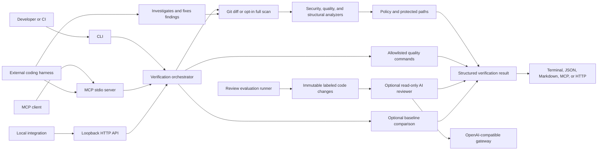

# Verify

**An independent verification platform for AI-assisted code changes.** Verify combines deterministic checks with an optional, read-only AI code review and returns one evidence-backed report through a CLI, MCP server, or local HTTP API.

AI agents can produce plausible code quickly. Teams still need a repeatable way to inspect what changed, run repository-approved checks, and keep the agent from declaring its own work safe. Verify puts that independent gate between a code change and a merge decision. Its core checks run without an LLM or provider credentials.

## What it does

- Scans changed files and added lines for likely secrets, sensitive-file changes, dangerous patterns, deleted tests, dependency changes, and infrastructure or CI configuration changes.
- Runs enabled tests, lint, and typecheck commands through a configured command allowlist, without a shell, with time and output limits.
- Applies protected-path policy and can compare findings with a saved baseline to distinguish introduced, persistent, and resolved issues.
- Exposes one verification engine to developers, CI jobs, and MCP clients, so each interface uses the same rules and status logic.
- Optionally sends screened, redacted changed lines to an independent FreeLLMAPI reviewer. It returns validated findings and evidence without reading or modifying repository files, and retries one time for transient gateway failures.
- Keeps external coding harnesses in control: they investigate findings, make changes, and request re-verification through MCP.

## Example output

The first image shows a real CLI run against an isolated demo repository containing intentional defects. Verify reported four blocking findings: a hardcoded credential pattern, an edited `.env`, dynamic evaluation, and a protected-file change. The demo repository is separate from this project.



The clean check runs the configured project tests and returns a passing report:



The MCP integration run shown here passed all six tests. A separate stdio smoke test listed the three tools and called `verify_changes` successfully.


## Quick start

**Requirements:** Node.js 20.12 or newer, pnpm 12.21.0, and Git.

```sh
pnpm install --frozen-lockfile
pnpm build
pnpm dev init                 # run once if the target repository lacks .verifyrc.json
pnpm dev scan --base main     # inspect changes against main
pnpm dev check --base main    # inspect changes and run enabled quality checks
```

Scan and check use the Git diff by default. Use `--all` to opt into scanning repository text files. Reports can be rendered as terminal, JSON, or Markdown:

```sh
pnpm dev scan --base main --format json > verify-result.json
pnpm dev report --input verify-result.json --format markdown
```

Exit codes are `0` for a pass, `1` for blocking deterministic findings, `2` for invalid arguments or configuration, and `3` for an execution error or an evaluation with incomplete model reviews. AI reviewer availability and findings are reported separately and do not change scan/check pass/fail status.

## Architecture

CLI, MCP, and HTTP adapters call the same orchestrator. Deterministic verification always runs locally; an explicitly requested read-only reviewer adds a separate findings layer.



### Verification flow

1. Load and validate project configuration.
2. Read changed Git content, or all eligible text files when `--all` is requested.
3. Run deterministic analyzers and apply policy.
4. For `check`, run enabled quality commands under the configured allowlist and limits.
5. If requested, send redacted changed lines to the AI reviewer and validate its structured findings against those lines.
6. Compare deterministic findings against an optional baseline and return a unified structured result.

The AI reviewer cannot edit files or approve its own output. Deterministic findings, AI findings, their evidence, confidence, and review status remain distinguishable in the report.

## Interfaces and integrations

| Surface | Use | Model provider required? |
| --- | --- | --- |
| CLI | Local reviews, scripts, and CI | No |
| MCP over stdio | Coding clients such as Codex and OpenCode | No |
| HTTP on loopback | Local tools that need a simple API | No |
| `review` / MCP `review_changes` | Add read-only model findings to deterministic checks | Yes |
| Evaluation runner | Compare explicit reviewers on labeled changes | Yes |

- [MCP setup and tools](docs/MCP.md)
- [HTTP endpoints and request format](docs/HTTP.md)
- [CLI commands and options](docs/CLI.md)
- [Configuration reference](docs/CONFIGURATION.md)

The MCP server uses stdio and does not open a network port. The HTTP API binds to loopback by default; it has no authentication layer and should not be exposed remotely.

## Technology stack

| Area | Technologies |
| --- | --- |
| Runtime and language | Node.js, TypeScript, ES modules |
| Package management and scripts | pnpm, tsx |
| Configuration and request validation | Zod |
| Model Context Protocol | `@modelcontextprotocol/sdk`, stdio transport |
| Model integration | OpenAI SDK with an OpenAI-compatible gateway; FreeLLMAPI is the configured default |
| HTTP | Node.js HTTP server, loopback-only by default |
| Build and types | TypeScript compiler, declarations, source maps |
| Tests | Vitest, V8 coverage, MCP client/server integration tests |

## Independent AI code reviewer

The reviewer is read-only and runs only when requested. Before sending changes to FreeLLMAPI, Verify redacts known credential formats and high-entropy opaque values, omits sensitive files and credential-like path components, and skips the request if secret-like material remains. It asks for evidence-backed structured findings, then validates each reported location and excerpt against the submitted change. Provider failures appear in `aiReview` metadata and leave deterministic status intact. A transient provider failure is retried at most once; the request count is included in reports.

```sh
cp .env.example .env
# Optional: set VERIFY_REVIEW_API_KEY for a separate review credential.
# Otherwise the reviewer reuses VERIFY_LLM_API_KEY. Keep .env untracked.
pnpm dev review --base main
pnpm dev models --review
```

Set `VERIFY_REVIEW_*` values only when review needs settings separate from the existing gateway. By default, review reuses `VERIFY_LLM_API_KEY`, `VERIFY_LLM_BASE_URL`, and `VERIFY_LLM_TIMEOUT_MS`, then uses `VERIFY_MODEL` or `auto`. Deterministic scans do not load or require provider settings. The external coding harness remains responsible for interpreting findings, making changes, and asking Verify to check them again. See [AI review configuration and data handling](docs/AI.md).

## Model evaluation

The evaluation runner compares two or three explicit model IDs against ten immutable fixtures across JavaScript, Python, and Go, including a benign control. Reports measure finding precision, recall, F1, severity mismatch, latency, usage, and cost when explicit prices are provided.

```sh
pnpm dev eval --benchmark benchmarks/tasks --models model-a,model-b
```

See [evaluation methodology](docs/EVALUATION.md). The bundled tasks are reproducible examples, not a broad model leaderboard.

## Development and validation

```sh
pnpm build
pnpm test
pnpm test:e2e
pnpm test:mcp
pnpm test:security
pnpm test:coverage
pnpm pack:check
```
