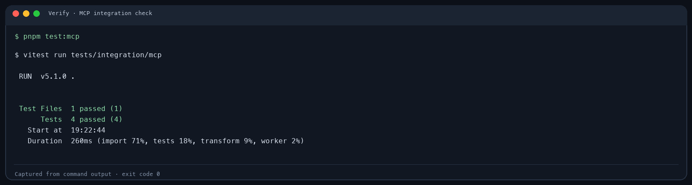
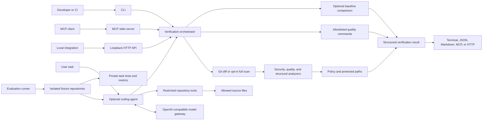

# Verify

**A deterministic verification layer for AI-assisted code changes.** Verify reviews a Git diff for security, quality, policy, and configuration risks, then returns the same structured result through a CLI, an MCP server, or a local HTTP API.

AI agents can produce plausible code quickly. Teams still need a repeatable way to inspect what changed, run repository-approved checks, and keep the agent from declaring its own work safe. Verify puts that independent gate between a code change and a merge decision. Its core checks run without an LLM or provider credentials.

## What it does

- Scans changed files and added lines for likely secrets, sensitive-file changes, dangerous patterns, deleted tests, dependency changes, and infrastructure or CI configuration changes.
- Runs enabled tests, lint, and typecheck commands through a configured command allowlist, without a shell, with time and output limits.
- Applies protected-path policy and can compare findings with a saved baseline to distinguish introduced, persistent, and resolved issues.
- Exposes one verification engine to developers, CI jobs, and MCP clients, so each interface uses the same rules and status logic.
- Optionally runs a bounded coding agent. The agent cannot edit verification controls, and only the deterministic verifier can mark its result as passing.

## Example output

The first image shows a real CLI run against an isolated demo repository containing intentional defects. Verify reported four blocking findings: a hardcoded credential pattern, an edited `.env`, dynamic evaluation, and a protected-file change. The demo repository is separate from this project.


The MCP adapter is exercised with an in-memory client/server integration test. This run passed all four MCP integration tests.



## Quick start

**Requirements:** Node.js 20.12 or newer, pnpm 12.21.0, and Git. The current Vitest development suite requires Node.js 22.12+, 24.x, or 26+.

```sh
pnpm install --frozen-lockfile
pnpm build
pnpm dev init                 # optional: create .verifyrc.json
pnpm dev scan --base main     # inspect changes against main
pnpm dev check --base main    # inspect changes and run enabled quality checks
```

Scan and check use the Git diff by default. Use `--all` to opt into scanning repository text files. Reports can be rendered as terminal, JSON, or Markdown:

```sh
pnpm dev scan --base main --format json > verify-result.json
pnpm dev report --input verify-result.json --format markdown
```

Exit codes are `0` for a pass, `1` for blocking findings, `2` for invalid arguments or configuration, and `3` for an execution error or an agent run that did not verify successfully.

## Architecture

The interfaces are adapters around one orchestrator. Analysis and pass/fail decisions stay in the deterministic core; optional model calls are kept on the agent path.



### Verification flow

1. Load and validate project configuration.
2. Read changed Git content, or all eligible text files when `--all` is requested.
3. Run deterministic analyzers and apply policy.
4. For `check`, run enabled quality commands under the configured allowlist and limits.
5. Compare against an optional baseline and return a structured result.

The agent can request edits, but it cannot approve its own output. A passing status comes from the same verifier used by the standalone CLI.

## Interfaces and integrations

| Surface | Use | Model provider required? |
| --- | --- | --- |
| CLI | Local reviews, scripts, and CI | No |
| MCP over stdio | Coding clients such as Codex and OpenCode | No |
| HTTP on loopback | Local tools that need a simple API | No |
| Optional agent | Bounded code changes followed by verification | Yes |
| Evaluation runner | Compare explicit models on isolated tasks | Yes |

- [MCP setup and tools](docs/MCP.md)
- [HTTP endpoints and request format](docs/HTTP.md)
- [CLI commands and options](docs/CLI.md)
- [Configuration reference](docs/CONFIGURATION.md)

The MCP server uses stdio and does not open a network port. The HTTP API binds to loopback by default; it has no authentication layer and should not be exposed remotely.

## Technology stack

| Area | Technologies |
| --- | --- |
| Runtime and language | Node.js, TypeScript, ES modules |
| Package management and scripts | pnpm, tsx |
| Configuration and request validation | Zod |
| Model Context Protocol | `@modelcontextprotocol/sdk`, stdio transport |
| Model integration | OpenAI SDK with an OpenAI-compatible gateway; FreeLLMAPI is the configured default |
| HTTP | Node.js HTTP server, loopback-only by default |
| Build and types | TypeScript compiler, declarations, source maps |
| Tests | Vitest, V8 coverage, MCP client/server integration tests |

## Optional coding agent

The deterministic verifier works independently of AI. To enable model-backed commands, copy `.env.example` to `.env`, start FreeLLMAPI, and set `VERIFY_LLM_API_KEY` and `VERIFY_LLM_BASE_URL`. Keep `.env` local and out of source control. The default model alias is `auto`, which lets FreeLLMAPI route and apply its configured fallback behavior.

```sh
pnpm dev models
pnpm dev agent --task "Fix the bug described in the issue" --task-type coding
```

The agent has bounded retries and restricted repository tools. It can read eligible repository text and write under `src/` outside verification controls; it cannot change tests, policies, configuration, analyzers, or its own controls. Each edit cycle is checked by the deterministic orchestrator. See [AI setup and boundaries](docs/AI.md).

## Model evaluation

The evaluation runner compares two or three explicit model IDs on bug-fix, feature, and security tasks. Each task/model run starts from a fresh fixture repository; hidden tests remain outside the agent workspace. Reports record task completion, hidden-test results, verification, regressions, model routing, usage, latency, and cost when explicit prices are provided.

```sh
pnpm dev eval --benchmark benchmarks/tasks --models model-a,model-b
```

See [evaluation methodology](docs/EVALUATION.md). The bundled tasks are reproducible examples, not a broad model leaderboard.

## Development and validation

```sh
pnpm build
pnpm test
pnpm test:e2e
pnpm test:mcp
pnpm test:security
pnpm test:coverage
pnpm pack:check
```

The adversarial analyzer checks currently cover four seeded detections and four benign samples; those small fixtures are regression checks, not estimates of real-world recall or false-positive rates. See [the security evaluation notes](docs/SECURITY_EVALUATION.md).

## Scope and limitations

The security analyzers use focused pattern checks. They are useful as a fast, deterministic review layer, but they do not replace a full static-analysis, dependency-audit, or secret-scanning program. Pattern checks can miss issues and can flag benign code. Review findings in context, especially before automating merge decisions. Quality commands run on the host and should be configured deliberately.

## Further reading

- [Architecture and trust boundaries](docs/ARCHITECTURE.md)
- [Contributing](CONTRIBUTING.md)
- [Baseline behavior](docs/BASELINE.md)
